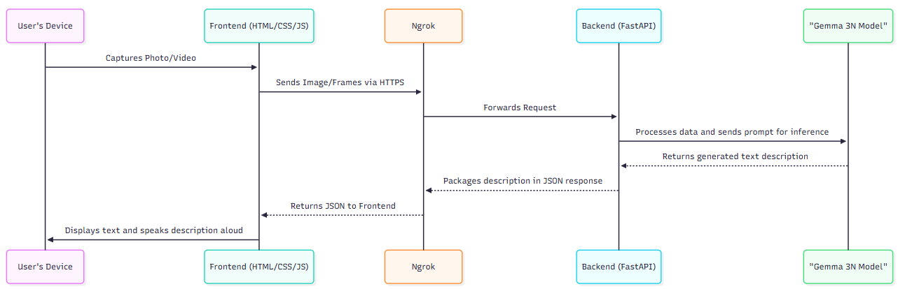
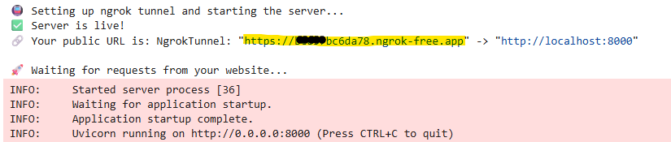

# BlindVision

## Summary

**Blind Vision** is an innovative web-based application designed to assist visually impaired individuals by providing real time descriptions of their surroundings. By using live camera feed, users can capture either a image or a short video clip. The application then leverages the advanced multimodal capabilities of **Google's Gemma 3N model** to generate a contextual description of the scene. The entire experience is enhanced with text-to-speech and speech-to-text functionalities, allowing for a seamless, hands-free interaction.

### Features

- Multimodal scene understanding using Gemma 3N
- Voice interaction with Speech-to-Text and Text-to-Speech
- Image and short video scene description
- Accessibility-focused design

---

## Demo

[](https://youtu.be/bfQcYQhKPz0)

Click the image above to watch the demo.

---

## **System Architecture**

The backend runs in a Google Colab notebook to leverage its free GPU resources. The data flow is straightforward, prioritizing a responsive and accessible user experience.

**Architectural Diagram:**



### Data Pipeline
```
Camera Input
      ↓
Frame Capture
      ↓
Backend API
      ↓
Gemma 3N Model
      ↓
Scene Description
      ↓
Text-to-Speech
      ↓
Spoken Response to User 
      ↓
(Optional Follow-up)
Speech-to-Text
      ↓
Backend API
      ↓
Gemma 3N Model
      ↓
Text-to-Speech
      ↓
Spoken Response to User
```

---

## **Core Functionality & Implementation**

The application has two primary modes:

* **Photo Mode**: The user points their camera and clicks "Describe Image." The frontend captures a single frame, sends it to the /describe-image/ backend endpoint, and receives a textual description from Gemma.

* **Video Mode**: When the user clicks "Record Video," the frontend captures a series of frames for 5 seconds. This sequence of frames is then sent to the /describe-video/ endpoint. Gemma analyzes the entire sequence to understand the context and any actions taking place, providing a more dynamic description.

To provide a truly hands-free experience, we've integrated the browser's native **Web Speech API**:
* **Text-to-Speech (speechSynthesis)**: All descriptions from the AI are automatically read aloud.
* **Speech-to-Text (speechRecognition)**: Users can click the microphone button to ask follow-up questions with their voice.

---

## **The Role of Gemma 3N**

Google's Gemma 3N is the core of this project. Its unique capabilities:

* **Multimodality**: Gemma 3N's ability to process and reason about both images and text simultaneously is what makes Blind Vision possible.
* **Instruction Following**: The model excels at following specific instructions, allowing us to guide it with prompts to get the exact type of descriptive output we need.
* **Efficiency**: By using the 4-bit quantized version of Gemma 3N provided by Unsloth, we can run this powerful model on a standard Colab T4 GPU, making the project accessible and easy to replicate.

---

## Accessibility Design

BlindVision was designed primarily for visually impaired users.

Accessibility features include:

- Voice-driven interaction using speech recognition
- Automatic spoken responses via text-to-speech
- Minimal visual UI requirements
- Hands-free interaction model

---

### **How to Use**

`Note`: The following instructions describe a `free` but temporary way to run this application using Google Colab and Ngrok. The live site at https://blindvision.netlify.app/ only works while the notebook is running. The server connection will expire after a couple of hours and the notebook needs to be restarted.

1.  **Open the Notebook in Colab**
    [](https://colab.research.google.com/github/JaisalJain/Blind-Vision/blob/main/backend/blindvision.ipynb)
    This opens `backend/blindvision.ipynb` from this repository.

2.  **Select the T4 GPU**
    Go to `Runtime > Change runtime type > T4 GPU`.

3.  **Add the Two Secrets**
    Open the Secrets panel (key icon in the left sidebar), add these two secrets and turn on notebook access for both:
    * `hugging_face`: your Hugging Face access token
    * `ngrok_token`: your ngrok authtoken

4.  **Run the Notebook**
    Run all cells (`Runtime > Run all`). It will load the model, start the backend server and initialize an ngrok tunnel.

5.  **Copy the Ngrok Public URL**
    Once ngrok initializes, it will generate a public HTTPS link.
   
  Copy the https: //xxxx.ngrok-free.app link — this is your temporary public API URL.

6.  **Paste the URL on the Website**
    Open https://blindvision.netlify.app/ and paste the link into the **Backend URL** field, then tap the ✓ button. The URL is saved in your browser, so you only need to paste it again when you restart the notebook. You can also open `https://blindvision.netlify.app/?api=<your-ngrok-url>`.

7.  **You're All Set!**
    Grant camera and microphone permissions when prompted and start interacting with the app.
    * *(`NOTE`: The first request may take 30-45 seconds to initialize the model. Subsequent requests are significantly faster!)*

---
### **📱 Running on a Mobile Phone**
How I ran it on a mobile phone:

1.  **Start the Backend Server:** Follow steps 1-5 in the "How to Use" section to run the Colab notebook and copy the `ngrok` URL.
2.  **Open the Website:** Open https://blindvision.netlify.app/ in your phone's browser and paste the `ngrok` URL into the **Backend URL** field.
3.  **Open and Test:** Allow camera and microphone access and start using the application.
* The live site only works while the notebook is running. This is a `free and temporary` way for faster testing.

---

## **On-device Experiment**

We also tried running Gemma 3N fully inside the phone's browser, with no server at all. The test used the `gemma-3n-E2B-it-int4-Web.litertlm` model (3.04 GB) with MediaPipe LLM Inference 0.10.29 on WebGPU, on a OnePlus 10R (8 GB RAM, Mali GPU, Chrome 155). The model was copied into browser storage in 41.7 s and loaded in 36.2 s, but MediaPipe warned that the GPU's `maxStorageBufferBindingSize` is only 256 MB, while LLM tasks need about 500 MB. On the first image, the WebGPU device was lost and the phone crashed and rebooted. Our conclusion is that in-browser Gemma 3N is not viable on this class of phone because of the WebGPU buffer limit, not total RAM. The test page and full results are in [experiments/on-device-webgpu](experiments/on-device-webgpu/).

---

## **Future Vision**

Blind Vision successfully demonstrates a powerful and practical application of Google's Gemma 3N model to solve a real-world accessibility challenge.

**Scaling from Prototype to Production:**

To scale this into a production grade service, we would:

1. **Achieve Ultra Low latency** : Our primary goal is to optimize every layer of the stack - from a faster model deployment on Vertex AI to network improvements - to provide near-instantaneous descriptions, making the experience feel truly real-time.
2. **Migrate the Backend**: Move the backend from the temporary Colab/Ngrok setup to a scalable backend (**Google Cloud Run**).
3. **Deploy the Model**: Host the Gemma 3N model on a specialized services for lower latency and higher throughput. For on-device inference, our [browser experiment](experiments/on-device-webgpu/) showed that WebGPU limits on mid-range phones are too low for Gemma 3N, so a native Android app using LiteRT-LM is the more realistic route.
4. **Use a CDN**: Deploy the frontend assets to a global **Content Delivery Network ** to ensure fast loading times for users everywhere.
5. **User Data**: Add a secure database to store preferences or history for personalization
6. **Personalization through facial detection**: Implement a facial recognition to personalize the user experience, this system will allow users to securely upload or capture images of family/friends, to enable relational descriptions.
7. **Smart Glasses Hardware Integration**: Design and build compact smart glasses equipped with cameras, to enable a fully `handsfree` experience, this will power AI vision assistance in daily life.


---

## Acknowledgments

I would like to thank the **Google Gemma team** for releasing a powerful and open multimodal model


